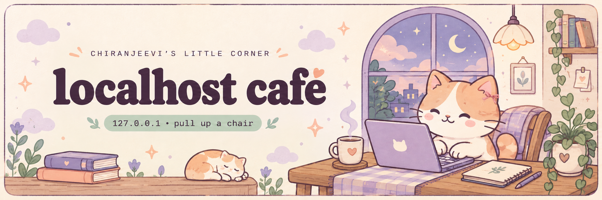

<p align="center">
  
</p>

<h1 align="center">hi, I’m Chiranjeevi Uddanti</h1>

<p align="center"><sub>ฅ^•ﻌ•^ฅ</sub></p>

<p align="center">
  <strong>AI product builder · aspiring Product Manager</strong><br />
  I want to build things that earn a place in someone’s day,<br />
  with security and privacy in mind.
</p>

<p align="center">
  Senior Software Engineer at Aviz Networks<br />
  Currently working on <a href="https://sonicfoundation.dev/about/">SONiC</a>, an open-source network OS,<br />
  and <a href="https://aviznetworks.com/products/ai-factory">AI Factory infrastructure</a>.
</p>

<p align="center">
  <a href="https://github.com/chiranjeevi-max?tab=repositories">browse the shelves</a>
  &nbsp;·&nbsp;
  <a href="https://www.linkedin.com/in/chiranjeevi-u/">LinkedIn</a>
</p>

## ☕ on the workbench

### [Packetfin](https://github.com/chiranjeevi-max/packetfin)

A Rust command-line packet analyzer for capture files and live traffic. In early development.

> 🧾 **behind the build**<br />
> **The friction:** finding the packets that explain a network problem.<br />
> **The idea:** decode, filter, and export traffic from the terminal.<br />
> **The detail:** memory budgets for packet reassembly and other cross-packet state.

`Rust` · `libpcap`

### [SnapTriage](https://github.com/chiranjeevi-max/SnapTriage)

An inbox for developers and maintainers triaging issues across GitHub and GitLab.

> 🧾 **behind the build**<br />
> **The friction:** issues scattered across repos and providers.<br />
> **The idea:** process them through one keyboard-driven inbox.<br />
> **The detail:** a five-second undo for mistaken actions.

`Next.js` · `React` · `TypeScript` · `Drizzle ORM`

## 🍡 a few things I love

`Rust` · `Go` · `C++` · `Python`

I like understanding how things work, from systems code to AI products.

A few small joys: bike rides, old Telugu melodies, and fried chicken. Hot chocolate is my comfort drink. ♡

## 🐍 snack break

Even the snake gets a little treat. Today’s menu: contribution squares.

<!-- Refreshed by .github/workflows/snake.yml. Local SVGs work before the first scheduled run. -->
<picture>
  <source media="(prefers-color-scheme: dark)" srcset="assets/contribution-snake-dark.svg" />
  <source media="(prefers-color-scheme: light)" srcset="assets/contribution-snake.svg" />
  
</picture>

<details>
  <summary>🐾 psst… pet the café cat</summary>

  <br />

  ```text
       /\_/\
      ( o.o )   purrr…
       > ^ <

  +1 tiny moment of happiness
  the cat has approved your commit.
  ```

</details>

<br />

<p align="center">
  <sub>come back soon ♡</sub>
</p>
